<p align="center">
  
</p>

<div align="center">

#  Optimux

**A self-hosted AI coding workspace that routes each task to the cheapest capable model, tracks every token and what it costs, and asks before running commands.**

It isn't limited to code: you can ask it anything you would ask a chat AI, and it can work on any files in a project folder (notes, documents, data).

[](https://www.python.org/)
[](https://fastapi.tiangolo.com/)
[](https://vuejs.org/)
[](https://github.com/BerriAI/litellm)
[](https://github.com/optiware-ai/optimux/actions/workflows/tests.yml)
[](LICENSE)
[](#project-status)

[Website](https://optimux.si) · [Features](#features) · [Quick start](#quick-start) · [How it works](#how-it-works) · [Documentation](docs/GUIDE.md) · [Security](#security) · [Contributing](CONTRIBUTING.md)

<br>

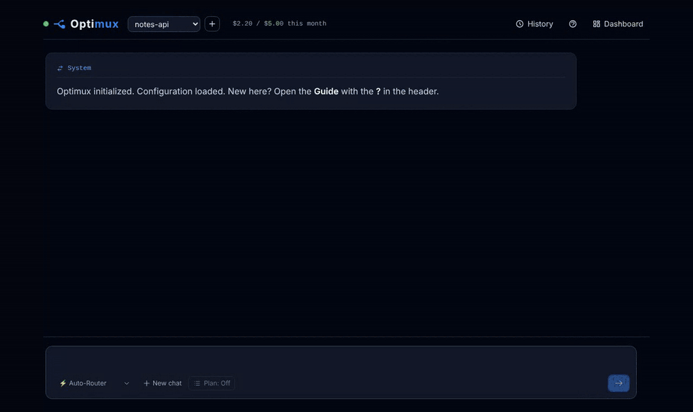

<sub>The cheap model takes the request, every command waits for your approval, and every call is metered.</sub>

</div>

---

## In one minute

Optimux helps you use AI models without wasting money.

It sends simple requests to cheap models, hands hard work to stronger models, tracks every token and every cent, and asks for your approval before it runs any command on your machine.

## How to start

1. **Install** Optimux with one command ([Quick start](#quick-start)).
2. **Add your API keys** in *Dashboard → Models*, and pick which model does what in *Dashboard → Routing*.
3. **Choose your workspace** folder in *Dashboard → Scope*.

   The installer can do steps 2 and 3 for you; you can change them later.
4. **Create your first project** in it with the **+** button next to the project name, or **clone one from your GitHub account** (add a GitHub token in *Dashboard → GitHub* first).
5. **Set the project's monthly budget** in *Dashboard → Budgets*.
6. **Start working** in the chat.

---

> ### Project status
> **Optimux is in beta (v0.1).** It is used every day on Linux and has a large test suite, but some paths have had little real-world use yet: server installs, macOS, and creating GitHub repositories from the app. Expect rough edges, and please [open an issue](https://github.com/optiware-ai/optimux/issues) when something breaks.

## Table of contents

- [In one minute](#in-one-minute)
- [How to start](#how-to-start)
- [Why Optimux](#why-optimux)
- [Features](#features)
- [How it works](#how-it-works)
- [Screenshots](#screenshots)
- [Requirements](#requirements)
- [Quick start](#quick-start)
- [Configuration](#configuration)
- [Using Optimux](#using-optimux)
- [Keeping costs down](#keeping-costs-down)
- [Security](#security)
- [Where your data lives](#where-your-data-lives)
- [Project structure](#project-structure)
- [Development](#development)
- [Roadmap](#roadmap)
- [Contributing](#contributing)
- [License](#license)
- [Acknowledgements](#acknowledgements)

## Why Optimux

**Built for** technical founders, solo developers and power users who use AI coding assistants every day and want control over what each request costs, which model answers it, and what runs on their machine.

Coding assistants are billed per token, and the price gap between models is huge. Most requests (a question, a lookup, a small edit) don't need the most expensive model, but most tools send everything to one model and give you a bill at the end of the month.

Optimux runs on your own machine, works on your own repositories, and treats **cost, speed and reliability as settings you control**:

- a cheap **Simple** model answers most requests, and a strong **Complex** model takes over only for hard tasks or when the Simple one gets stuck;
- every model call is **metered** (tokens, cache hits, thinking, cost, time) and **budgets** stop a project before it overspends;
- prompts are kept **small and cache-friendly**: short memory, skills that cost nothing until used, prompt caching where the provider supports it;
- commands run only **after your approval**, and optionally in a **sandbox** that can change nothing but the project.

## Features

**Routing**
- Two tiers, Simple and Complex, with automatic **escalation** when the Simple model hits its step limit or repeats itself.
- A **Conductor** (one small call per message) picks the tier; it never moves an unfinished task to a weaker model.
- **Fallback** and **cooldowns** when a provider fails or a quota runs out.
- Pin a tier with `/simple` or `/complex`, or force a specific model for your requests.
- Per-model **thinking level** (Minimal to High).

**Working on code**
- A terminal tool with **per-command approval**, exit codes and a syntax-highlighted output viewer.
- **Projects** inside a **Workspace** folder: create one with a form (name, starter files, git, a private or public **GitHub** repository, description), from the **+** button for free or by asking the model, which fills the form in for you.
- **GitHub set up from the web interface** (or the installer): a token checked with GitHub before it's saved, used only to create or clone repositories, never visible to model-run commands.
- **Clone from GitHub**: pick one of your repositories and it becomes a project (background clone with progress and cancel; no model involved). Folders added to the Workspace by hand show up live.
- **Scope checks** that flag commands touching paths outside the project.
- A **bubblewrap sandbox**: commands can only change the active project; your home folder and keys are invisible.
- **Ready for a server**: password sign-in with optional two-step codes, a strict content security policy, and a [deployment kit](deploy/) (HTTPS with Caddy, a hardened systemd unit).
- **Commands run lean**: only an allow-list of environment variables (never keys), with per-command limits on memory, file size and processes.

**Security and sign-in**
- **Password sign-in** (scrypt) with optional **two-step codes** from an authenticator app; failed attempts are rate-limited.
- **New sign-in notices**: every open page shows when another browser signs in, with one click to sign the others out; the list of signed-in browsers updates live.
- A **security checklist** in the Dashboard (HTTPS, two-step codes, sandbox, network, approvals, server mode).
- Model replies are sanitized and the page runs only Optimux's own scripts, all served locally at pinned versions.

**Installing and running**
- **One-line installer** for your computer or a VPS, with an interactive terminal interface; every question can be skipped and changed later in the web interface. On a VPS it also sets up HTTPS, a dedicated user, the firewall and **server mode**: the sandbox is required, every command needs approval, and commands have no network by default.
- An **`optimux` command**: start, stop, status, logs, update, password and uninstall.

| | On your computer | On a server (VPS) |
|---|---|---|
| Installer choice | "This computer" | "A server (VPS)" |
| Who can reach it | only you, at `http://127.0.0.1` | you, from anywhere: HTTPS on your domain (Caddy), or an SSH tunnel |
| Server mode (`OPTIMUX_SERVER=1`) | off | on |
| Sandbox | recommended (the installer offers it) | required |
| Command approval | every command, by default; auto-approve can be turned on | every command, always |
| Network for commands | on by default | off by default |
| Runs as | your user | a dedicated `optimux` user, as a hardened systemd service |
| Program and data | `~/.local/share/optimux`, `~/.optimux` | `/opt/optimux`, `/var/lib/optimux` |
| Firewall and security updates | your own setup | offered by the installer |
| Managed with | `optimux start \| status \| update …` | `sudo optimux start \| status \| update …` |

Server mode is set by the installer; you only set `OPTIMUX_SERVER=1` yourself when you install on a server by hand.

**A server without a domain** is reached through an SSH tunnel that you run **on your own computer**: `ssh -N -L 8000:127.0.0.1:8000 you@your-server`, then open http://localhost:8000. The installer prints the exact command, and `sudo optimux open` shows it again ([details](docs/GUIDE.md#without-a-domain-the-ssh-tunnel)).

**Memory and skills**
- Personal, professional and per-project **memory**, sent with every request.
- **Automatic project memory**: after a chat, the cheap model keeps the project's facts up to date, under a size cap, with a full history, diffs and undo.
- **Skills**: reusable instructions you run with `/name`. Manual skills cost nothing while idle; Auto skills can be picked by the model.

| | Personal | Professional | Project |
|---|---|---|---|
| What goes in it | your name, language, how you like answers | coding style, commit habits, general rules | build and test commands, stack, structure, conventions, decisions, known issues |
| Used in | every chat, in every project | every chat, in every project | chats in that project only |
| Sent to the model | with every request | with every request | with every request in that project |
| Changed by | you, or the model when you ask it to remember | you, or the model when you ask it to remember | you, the model when asked, and **automatic updates** |
| Automatic updates | never | never | when a chat ends (or after 10 idle minutes): the cheap model keeps durable facts only, under about 1,500 tokens; can be turned off |
| History and undo | no | no | every change, with a diff, its cost and **Undo** |
| Where it is kept | `~/.optimux/memory/personal.md` | `~/.optimux/memory/professional.md` | `~/.optimux/memory/projects/<project>.md` |
| Settings | Dashboard → Memory | Dashboard → Memory | Dashboard → Memory → Project: on/off, idle minutes, **Update now**; Budgets: a warning before **Update now** |

Memory costs tokens on every model call, so short and precise memory is cheaper **and** works better. A Workspace chat (no project selected) uses personal and professional memory only.

**Costs and data**
- Live cost while a reply runs, and a cost line under every reply.
- **Dashboard**: overview, usage by project, role, model and skill, a 30-day cost chart, budgets, history with filters.
- **Monthly budgets** per project (block or warn) and **cost warnings** before paid one-off actions.
- Every chat and every model call is stored in SQLite and **survives restarts**, with daily backups.
- **Snapshots** of everything (or only your data, or only your projects), kept on the machine (Dashboard → Backups): see what goes in, take one in the background, within a space limit.

**Interface**
- A single-page web app: chat, history, dashboard and an in-app **[Guide](docs/GUIDE.md)** with search.
- Help on every setting (**?** tips), `/` command completion, Markdown export of any reply or chat.

## How it works

<p align="center">
  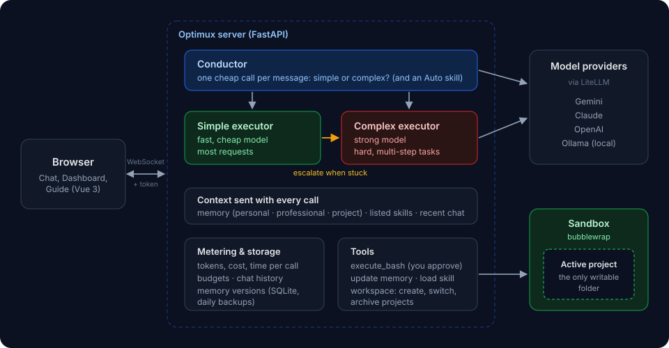
</p>

1. You send a message from the browser over an authenticated WebSocket.
2. The **Conductor** classifies it as simple or complex (and may pick an Auto skill).
3. The chosen **executor** model answers, with your memory and the recent chat as context. It may call tools: a shell command (after your approval, in the sandbox if enabled), a memory update, a skill, or a Workspace action.
4. If the Simple model gets stuck, the turn **escalates** to the Complex model with the whole conversation.
5. Every call is **metered** and checked against the project's **budget**; the chat is stored as it happens.

A detailed walkthrough of each part is in the [Guide](docs/GUIDE.md#how-routing-works).

## Screenshots

<p align="center">
  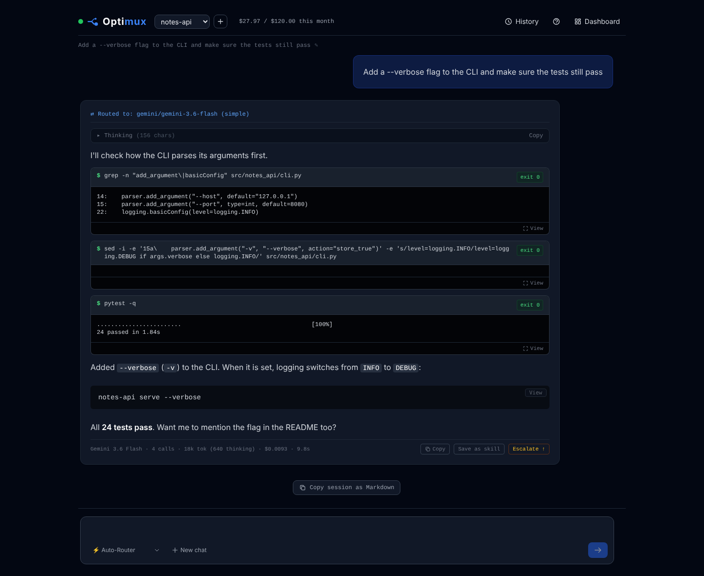
  <br><sub><b>Chat</b>: the route, each command with its exit code, the answer and its cost</sub>
</p>

<table>
  <tr>
    <td width="50%">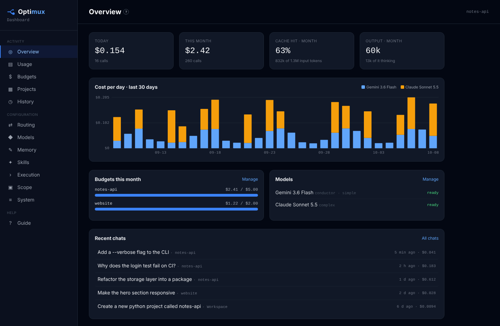<p align="center"><sub><b>Overview</b>: spending, cache hits, budgets, models, recent chats</sub></p></td>
    <td width="50%">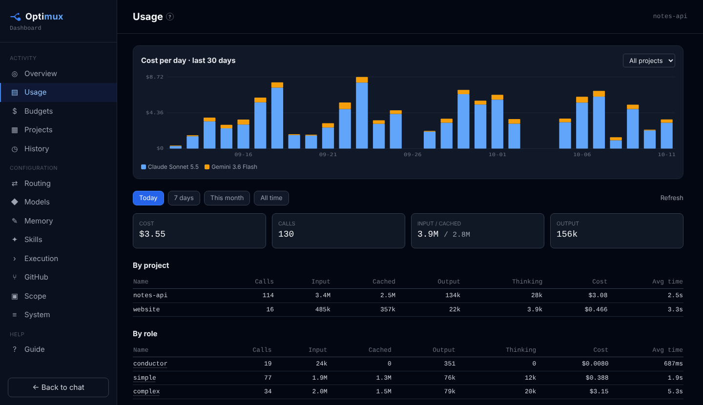<p align="center"><sub><b>Usage</b>: tokens, cost and time by project, role, model and skill</sub></p></td>
  </tr>
  <tr>
    <td>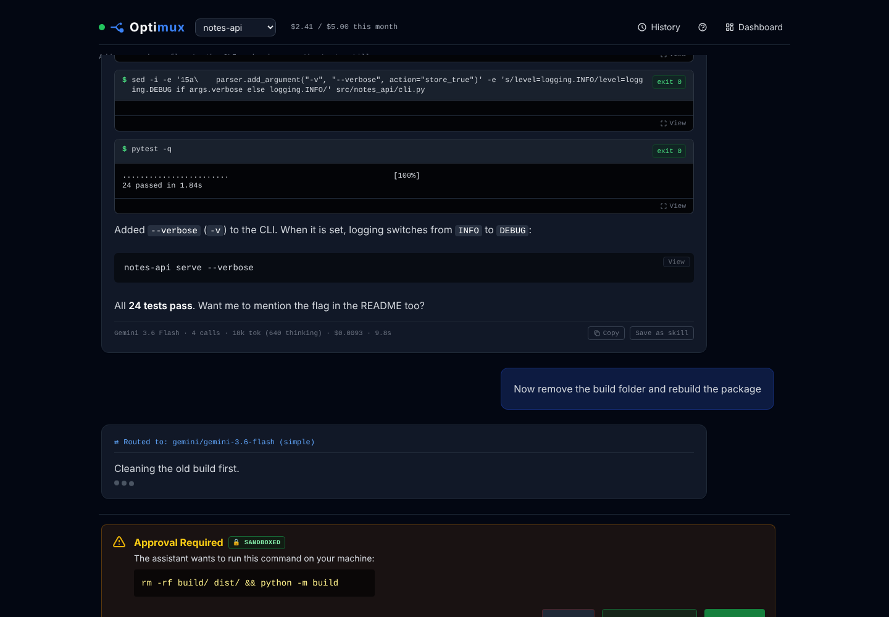<p align="center"><sub><b>Approvals</b>: every command waits for you, with its sandbox status</sub></p></td>
    <td>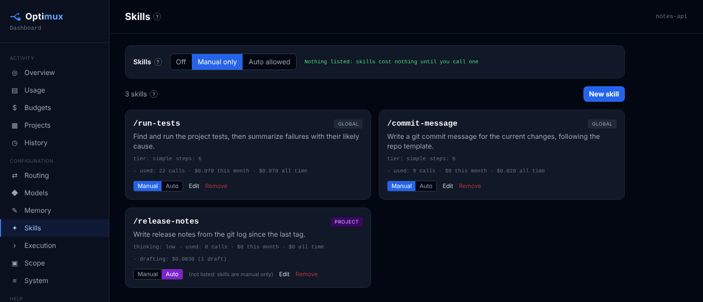<p align="center"><sub><b>Skills</b>: Manual (free while idle) or Auto</sub></p></td>
  </tr>
  <tr>
    <td>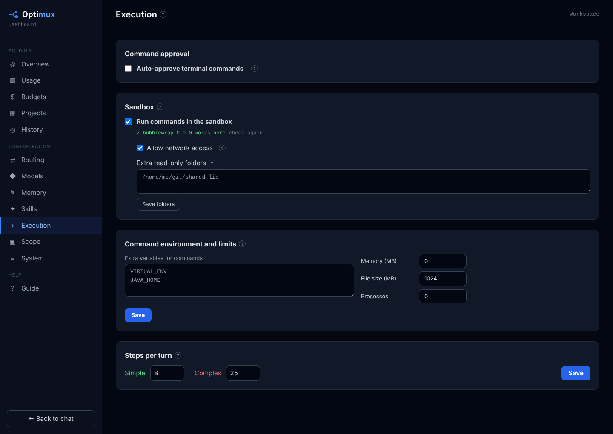<p align="center"><sub><b>Execution</b>: sandbox, network switch, command environment and limits</sub></p></td>
    <td>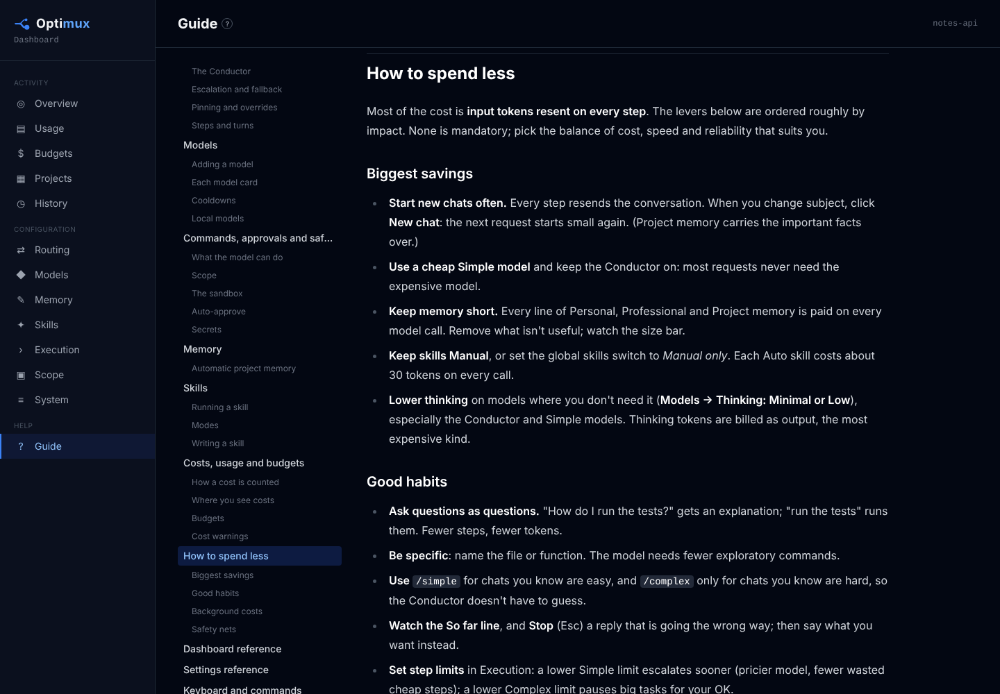<p align="center"><sub><b>Guide</b>: the full manual, inside the app</sub></p></td>
  </tr>
  <tr>
    <td>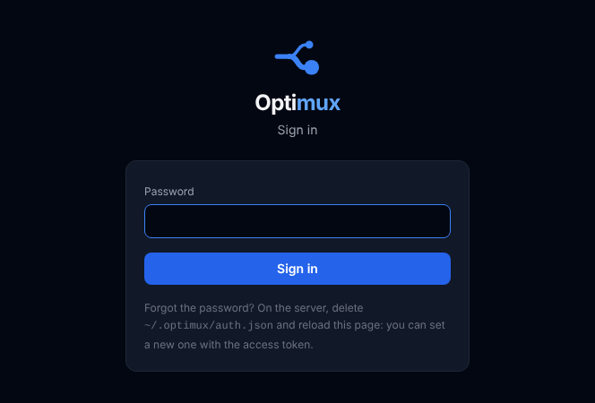<p align="center"><sub><b>Sign-in</b>: password, plus two-step codes if you turn them on</sub></p></td>
    <td>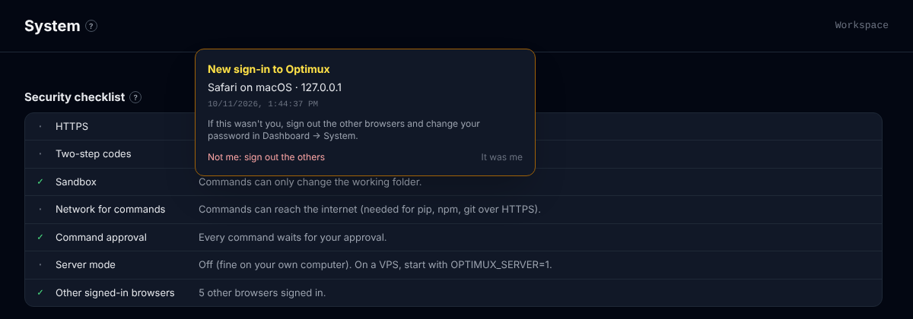<p align="center"><sub><b>Security</b>: the checklist, and a notice when another browser signs in</sub></p></td>
  </tr>
</table>

## Requirements

| | |
|---|---|
| **OS** | Linux (recommended; required for the sandbox) or macOS |
| **Python** | 3.10 or newer |
| **Models** | An API key for at least one provider supported by [LiteLLM](https://docs.litellm.ai/docs/providers) (Gemini, Anthropic, OpenAI, …), or a local [Ollama](https://ollama.com/) model |
| **Optional** | [`bubblewrap`](https://github.com/containers/bubblewrap) for the sandbox, `git`, and the [GitHub CLI](https://cli.github.com/) (`gh`) to create repositories |

## Quick start

```bash
curl -fsSL https://raw.githubusercontent.com/optiware-ai/optimux/main/install.sh | bash
```

<p align="center">
  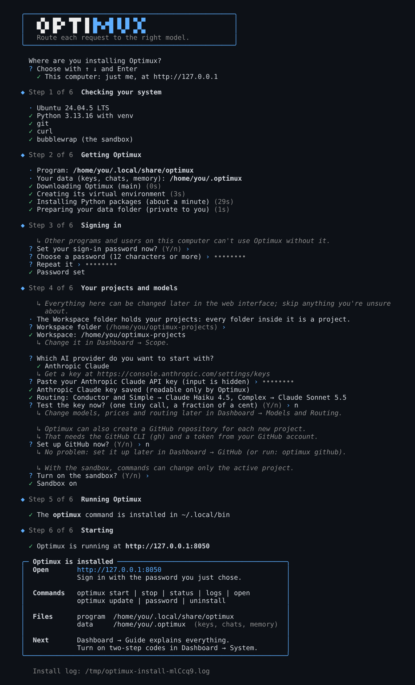
</p>

An interactive installer for **your computer** or a **server (VPS)**. It installs what's missing, sets up its own virtual environment, the sandbox and private file permissions, and asks for your password, Workspace folder and first API key. Each question can be skipped and changed later in the web interface. On a server it adds HTTPS (Caddy), a dedicated user, a hardened systemd service and the firewall. Afterwards, `optimux start | stop | status | update | uninstall` manages it.

<details>
<summary>Install by hand instead</summary>

```bash
git clone https://github.com/optiware-ai/optimux.git
cd optimux
python3 -m venv venv && source venv/bin/activate
pip install -r requirements.txt
sudo apt install bubblewrap        # the sandbox (Debian/Ubuntu;  Fedora: dnf install bubblewrap)
uvicorn optimux_backend.main:app --host 127.0.0.1 --port 8000
```

Open **http://127.0.0.1:8000**, paste the **access token** the server printed (also in `~/.optimux/secrets.env`), and choose your password. Then add a model in **Dashboard → Models**, pick **Routing**, set the **Workspace folder** in **Scope** and turn on the **Sandbox** in **Execution**.

</details>

The [Guide](docs/GUIDE.md#getting-started) walks through each step.

> [!WARNING]
> Optimux runs commands on your machine. When installing by hand, keep `--host 127.0.0.1`, or put HTTPS (for example an SSH tunnel) in front of it. On a server that others can reach, use the installer's server mode (or `OPTIMUX_SERVER=1`).

## Configuration

Almost everything is configured in the Dashboard and stored under `~/.optimux`. A few things are set with environment variables:

| Variable | Default | Purpose |
|---|---|---|
| `OPTIMUX_HOME` | `~/.optimux` | Where Optimux keeps settings, keys, chats, usage and memory. |
| `OPTIMUX_TOKEN` | generated | The access token. Normally read from `secrets.env`; set it to choose your own. |
| `OPTIMUX_SERVER` | unset | `1` for a server others can reach: sandbox required, auto-approve off, commands without network by default, HTTPS-only cookies. See [Running on a server](docs/GUIDE.md#running-on-a-server). |
| `OPTIMUX_REQUIRE_SANDBOX` | unset | `1` forces the sandbox on; it can't be turned off from the Dashboard. |
| `OPTIMUX_ALLOWED_ORIGINS` | unset | Comma-separated extra web origins allowed to use Optimux from a browser. |

All settings, with their defaults, are listed in the [Guide's settings reference](docs/GUIDE.md#settings-reference).

## Using Optimux

| In the chat | What it does |
|---|---|
| `/new` | Start a new chat (cheaper: the model forgets the old one) |
| `/simple`, `/complex` | Pin the tier for this chat |
| `/<skill>` | Run a skill, e.g. `/run-tests only the unit tests` |
| `/` | Show commands and skills with completion |
| <kbd>Enter</kbd> / <kbd>Shift</kbd>+<kbd>Enter</kbd> | Send / new line |
| <kbd>Esc</kbd> | Stop the running request (or close a dialog) |

Choose **Workspace** in the project menu to manage projects, or a project to work on its code. The **+** next to the menu creates a project (or ask: "create a new python project called notes-api"). The [Guide](docs/GUIDE.md#the-workspace-and-projects) explains the difference.

## Keeping costs down

The biggest levers, all built in:

- **Start new chats often**: every step resends the conversation.
- **Use a cheap Simple model** and let the Conductor escalate only when needed.
- **Keep memory short**: it is sent with every call (the Memory page shows its size).
- **Keep skills Manual**: Auto skills add about 30 tokens to every call.
- **Lower thinking** on models that don't need it.
- **Set budgets** with *Block*, and keep **cost warnings** on.

The [How to spend less](docs/GUIDE.md#how-to-spend-less) chapter covers every lever.

## Security

- **Sign-in** with a password (scrypt) and optional two-step codes (TOTP); sessions in an HttpOnly, SameSite=Strict cookie; failed attempts limited per address. Scripts can use the access token instead.
- **Browser hardening**: model output is sanitized before display; a strict Content Security Policy allows only Optimux's own scripts, all served locally at pinned versions (no CDN); no framing; cross-site changes are refused.
- **Approval** for every command; commands touching paths outside the project are flagged and never auto-approved.
- **Sandbox** (bubblewrap): the system is read-only, only the working folder is writable, home folders and Optimux's keys are hidden, `/tmp` is private, the network can be cut. It fails closed: if bubblewrap is unavailable, commands are refused.
- **Secrets** live in `~/.optimux/secrets.env` (mode 600); commands get an allow-list of environment variables, never keys, plus per-command resource limits.
- **Server mode** (`OPTIMUX_SERVER=1`) and a [deployment kit](deploy/) for running on a VPS behind HTTPS.
- **Nothing Optimux stores** goes into your repositories.

Limits and recommendations are in the [Guide](docs/GUIDE.md#security). Please report vulnerabilities privately, as described in [SECURITY.md](SECURITY.md), not in a public issue.

## Where your data lives

```
~/.optimux/
├── config/       settings, models, routing, budgets
├── secrets.env   API keys and the access token (mode 600)
├── auth.json     password hash and two-step secret (mode 600)
├── data/         optimux.db: chats, every model call, memory history
├── backups/      daily database copies (14 kept)
├── snapshots/    Data and Workspace snapshots (Dashboard → Backups)
├── memory/       personal.md, professional.md, projects/<name>.md
├── skills/       global skills
├── logs/
└── legacy/       old and removed files (moved, never deleted)
```

Chats and usage are never cleared by restarts or updates. Nothing is sent anywhere except to the model providers you configure.

## Project structure

```
optimux/
├── optimux_backend/
│   ├── main.py              FastAPI app: REST API, WebSocket, the agent loop
│   └── core/                routing prompts, LLM client, executor, sandbox, security,
│                            memory and curator, skills, workspace, sessions, usage, budgets, store
├── index.html               the web app's page (Vue 3 templates)
├── web/                     app.js, the sign-in page, styles, pinned libraries (vendor/)
├── deploy/                  running on a server: systemd unit, Caddyfile, AppArmor profile
├── install.sh               the one-line installer (local or server) and the optimux command's logic
├── scripts/optimux          the optimux command; scripts/build-css.sh rebuilds web/app.css
├── docs/
│   ├── GUIDE.md             the user guide (also shown in the app)
│   └── images/              screenshots and diagrams
└── tests/                   pytest suite
```

Each source file has a companion `*_AGENT.md` describing what it does and how it connects to the rest. [PIPELINE.md](PIPELINE.md) has the full file tree.

## Development

### Running the tests

```bash
source venv/bin/activate
pytest -q
```

The suite runs without network access or API keys: model calls are mocked, and a temporary `OPTIMUX_HOME` is used. Sandbox tests run for real where bubblewrap works and are skipped otherwise.

The same tests and `shellcheck` run on GitHub Actions for every push and pull request to `main` (Python 3.10 and 3.13): see [`.github/workflows/tests.yml`](.github/workflows/tests.yml).

### Conventions

- **Sidecars**: when you change `foo.py`, update `foo.py_AGENT.md` in the same commit.
- **Commits** follow [`commit-template.txt`](commit-template.txt): `[ TYPE ] Scope: Description`, a list of files, then motivation, changes, validation and deployment notes.
- **Docs**: user-visible changes update [docs/GUIDE.md](docs/GUIDE.md); `tests/test_guide.py` fails if defaults quoted in the guide drift from the code.

## Roadmap

- **Measured local-model delegation**: hand narrow, checkable tasks (output compression, titles, embeddings) to free local models where it pays off.
- **Security, phase 2** (before 1.0): an audit log, masking secrets in command output, dependency scanning and signed releases, then an independent penetration test.
- **Teams** (a later generation): several users, roles, and keys and budgets per user.
- **Configurable command timeout** (30 seconds today).

## Contributing

Bug reports, ideas and questions are very welcome in [issues](https://github.com/optiware-ai/optimux/issues). Pull requests from outside contributors aren't accepted yet, while the contributor agreement is being prepared; see [CONTRIBUTING.md](CONTRIBUTING.md).

To report a security problem, please don't open an issue: see [SECURITY.md](SECURITY.md).

## License

Copyright (C) 2026 Masoud Valizadeh.

Optimux is free software: you can redistribute it and/or modify it under the terms of the [GNU Affero General Public License version 3](LICENSE) (AGPL-3.0-only). If you run a modified version for other people over a network, the AGPL asks you to offer them its source code.

## Acknowledgements

Optimux is built on [FastAPI](https://fastapi.tiangolo.com/), [LiteLLM](https://github.com/BerriAI/litellm), [Vue](https://vuejs.org/), [Tailwind CSS](https://tailwindcss.com/), [marked](https://marked.js.org/), [highlight.js](https://highlightjs.org/) and [bubblewrap](https://github.com/containers/bubblewrap).
